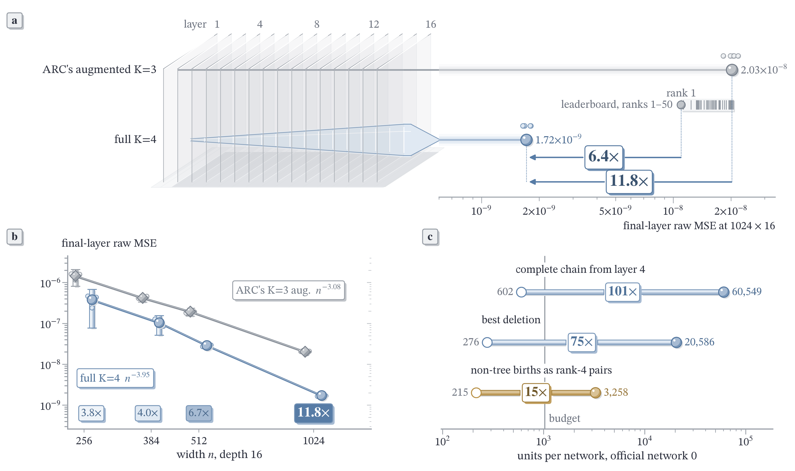
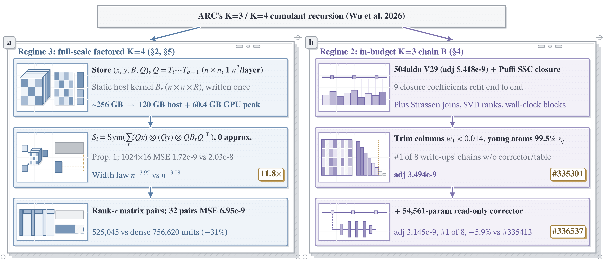

# Scaling Exact Fourth-Order Cumulant Propagation to 1024 × 16: Zero-Sample K=4 via Factored n³-Memory Transport Cuts Error 11.8× Below Augmented K=3 and Reveals Why Memoryless Closures Stall

This repository rebuilds every table and figure of [the report](report.pdf) (ARC White-Box Estimation Challenge 2026, Phase 2), runs our scored entry #336537 exactly as submitted, and holds the K=4 research chain behind its 1024-wide numbers. Forum write-up: [discourse.aicrowd.com/t/18254](https://discourse.aicrowd.com/t/18254).



That chain carries the complete fourth cumulant through the challenge's 1024 × 16 networks with zero samples and zero fitted constants, stored as birth legs, birth kernels and one cumulative transport per group, which is exact at every layer. It reaches raw final-layer MSE **1.72e-9** on official public networks 0–4, **11.8× below** ARC's augmented K=3 (2.03e-8), and over widths 256–1024 its error falls as n^−3.95 (95% interval 3.68–4.08) against n^−3.08 (2.95–3.17), the first empirical confirmation at the challenge scale of the fourth- and third-order width exponents of the c_K (L/n)^K bound conjectured by Wu et al. (2026, Section 5). Every projection step is measured through the whole 16-layer chain, as [ARC's deduction–projection account](https://www.alignment.org/blog/mechanistic-estimation-for-expectations-of-random-products/) asks, and the first compressed K=4 chains are metered end to end: rank-32 matrix pairs hold 6.95e-9 at 525,045 units, 30.6% fewer than dense kernels. Full K=4 runs outside the 2⁴¹-FLOP budget. Inside it, #336537, a K=3 chain with a learned corrector, scores adj **3.145e-9**, the lowest of the eight public Phase 2 write-ups and 5.9% below the next, and its chain alone, #335301, ranks first among the eight write-ups' chains without a learned corrector or mean-correction table.

| Goal | Command | Hardware |
|---|---|---|
| watch full K=4 beat augmented K=3 live on three 128 × 16 networks, every FLOP charged by flopscope, then check all 1,935 frozen readings | `laptop_exact.py`, `verify.py` | a laptop: 15–20 s, under 1.8 GiB |
| rebuild every table and figure, check the headline numbers | `make_tables.py all`, `make_figures.py`, `verify.py` | a laptop |
| run #336537 as submitted | `smoke.py` | a laptop |
| switch our pieces of chain B off on 50 networks (Table 5) | `ablation/summarize.py --panel 50`; rerun with `ablation/matrix.py` | a laptop; 16 GiB RAM to rerun |
| rerun full K=4 and reference K=3 at 1024 × 16 (Tables 1–3) | `lab/k4full.py`, `lab/ref1024.py` | one 80 GiB GPU, 240 GiB RAM |

Every headline number of the report, where it is drawn and the key that holds it:

| Headline claim | Report table/figure | `numbers.csv` key | Verification command |
|---|---|---|---|
| full K=4 1.72e-9 against augmented K=3 2.03e-8: 11.8× lower on all five official networks | Table 1, Figure 0 | `k4_full_1024_nets0_4`, `k3aug_1024_nets0_4`, `ratio_k3aug_over_k4_1024` | `python3 verify.py` |
| first confirmation at 1024 × 16 of the width exponents 4 and 3 of the c_K (L/n)^K bound conjectured by Wu et al. (2026): n^−3.95 (3.68–4.08) against n^−3.08 (2.95–3.17) | Figure 1b, Section 1 | `width_exponent_k4` (`_ci_lo`, `_ci_hi`), `width_exponent_k3a` (`_ci_lo`, `_ci_hi`) | `python3 verify.py` |
| augmented K=3 handed the K=4 chain's exact C and κ4 reaches 0.29×; the K=4 chain 0.08× | Table 3c, Figure 3a | `oracle_C_k4`, `oracle_full_k4_chain` | `python3 verify.py` |
| two birth families hold 96% of 60,549 units; rank-4 pairs take the tie distance from 75× to 15× | Tables 9 and 11, Figure 0c | `red_share_ck3` + `red_share_nontree`, `red_tie_gap_w20586`, `red2_w9_n4_gap` | `python3 verify.py` |
| #336537 first of the eight public Phase 2 write-ups, 5.9% below the next | Tables 0 and 4b | `nb_us_adj`, `nb_us_rank_of_writeups`, `nb_us_below_next_adj` | `python3 verify.py` |
| #335301 ranks first among chains without a learned corrector or mean-correction table: adj 3.494e-9, 1.3% below #334316 | Table 4b | `nb_chainb_adj`, `nb_chainb_rank_no_corrector_no_table`, `nb_chainb_over_hyojun_base_adj` | `python3 verify.py` |
| whole chain with 32 matrix pairs, metered over all 16 layers: 6.95e-9 at 525,045 units, 30.6% fewer than dense kernels (6.37e-9 at 756,620); 8 pairs 8.34e-9 at 512,138 | Table 12, Figure 5a capsules | `e2e_p32_net0_raw`, `e2e_p32_net0_units`, `e2e_p32_over_m1_units`, `e2e_m1_net0_raw`, `e2e_m1_net0_units`, `e2e_p8_net0_raw`, `e2e_p8_net0_units` | `python3 verify.py` |
| at one raw, the dense metered run bills 12.5× the 60,549 units the ledger counts | Table 12, Figure 5a arc | `e2e_m1_net0_units`, `e2e_m1_over_counted` | `python3 verify.py` |

`python3 verify.py` checks every key in about 2 s on a laptop; one key prints with `grep '^ratio_k3aug_over_k4_1024,' data/numbers.csv`, and the same pattern works for any key in the table.

Figure M in §2 of [the report](report.pdf) shows the full-scale factored K=4 and budget-pruned K=3 chains on two tracks.



```text
+----------------------------------------------+   +----------------------------------------------+
|       Track 1: Exact K=4 at 1024 x 16        |   |      Track 2: In-Budget K=3 + Corrector      |
|              Input Weights W_l               |   |              Input Weights W_l               |
|                      |                       |   |                      |                       |
|                      v                       |   |                      v                       |
|         Birth-Factored Legs & Kernel         |   |   Readout-Observability Pruning <g, delta>   |
|                      |                       |   |                      |                       |
|                      v                       |   |                      v                       |
|        Cumulative Transport Q_{b->l}         |   |           State-Carried Corrector            |
|                      |                       |   |                      |                       |
|                      v                       |   |                      v                       |
|      Exact K=4 Readout: 1.72e-9 raw MSE      |   |       #336537: 3.145e-9 adjusted error       |
+----------------------------------------------+   +----------------------------------------------+
```

The first row, from a fresh clone:

```bash
git clone https://github.com/logxio/fourth-cumulant.git fourth-cumulant && cd fourth-cumulant
python3 -m venv .venv && source .venv/bin/activate && pip install -r requirements.txt
python laptop_exact.py && python verify.py
```

```text
seed 3: K4 raw=1.223533273e-05 units=366.679227; K3a raw=5.100159135e-05 units=26.763125; K3a/K4=4.168x; CPU=14.28s RSS=515.3MiB
seed 4: K4 raw=3.129622230e-05 units=366.679227; K3a raw=6.265472083e-05 units=26.763125; K3a/K4=2.002x; CPU=14.36s RSS=516.2MiB
seed 5: K4 raw=1.604079576e-05 units=366.679227; K3a raw=5.099867608e-05 units=26.763125; K3a/K4=3.179x; CPU=14.25s RSS=515.3MiB
mean: K4 raw=1.985745026e-05; K3a raw=5.488499609e-05; K3a/K4=2.764x
run: wall=14.87s RSS<=1570.9MiB
Estimator hash, 1,935 frozen numeric readings, ten saved official pages, derived write-up comparisons, leaderboard cross-checks, Table 4b, and Figures 0, 5 and M match.
```

K4 carries every fourth-cumulant source with its two birth legs, dense birth kernel and cumulative transport `Q`, with no rank truncation; K3a is ARC's augmented K=3 with its fourth-order radial feedback. Both run on the same weights and score final-layer raw MSE against 10,100,736-sample antithetic Monte Carlo truth whose hashes are pinned in [`LAPTOP_EXACT_PREREG.md`](LAPTOP_EXACT_PREREG.md): full K=4 is 2.0–4.2× lower on every network. Flopscope units reproduce to every printed digit across Python 3.10–3.13; raw MSE agrees to four significant digits on 3.10 and to every printed digit on 3.11–3.13 in the tested environments. The timing line is one Apple M5 run; `python laptop_exact.py --seed 3` runs a single network in one process. The four-version readings are in [`REPRODUCE.md`](REPRODUCE.md).

## Check the numbers

Python 3.10+; `manifest.json` records the exact grader versions:

```bash
git clone https://github.com/logxio/fourth-cumulant.git fourth-cumulant && cd fourth-cumulant
python3 -m venv .venv && source .venv/bin/activate
pip install -r requirements.txt

# 1. #336537 on one generated 128 × 16 network: a finite (16, 128) prediction and its FLOP count
python smoke.py

# 2. Tables 1–12 (including 4b) and A1–A4 into tables/, Figures 0–5 and M into figures/
python make_tables.py all && python make_figures.py

# 3. refit the nine SSC coefficients, rescore both ablation panels, check everything
mkdir -p outputs && (cd outputs && python ../lab/cand_ssc/fit_knobs.py ../lab/cand_ssc/jc/pert.json inrun \
    ../lab/cand_ssc/data/j1_a_final.npz ../lab/cand_ssc/data/j1_b_final.npz --ridge 0.01 --cfgdir lab/cand_ssc/jc)
python ablation/summarize.py && python ablation/summarize.py --panel 50 && python verify.py
```

`verify.py` checks the estimator and frozen-number hashes, ten official submission pages, derived comparisons, the 32-pair meter receipt and Table 4b. `verify.py --full` additionally checks the SSC fit, headline tables and figures, saved predictions and star-birth weights. `data/numbers.csv` marks each value as measured or derived, and `REPRODUCE.md` gives the commands with their outputs and expected values.

## What our pieces of chain B are worth

#336537 is chain B plus a learned corrector. Chain B is our K=3 chain: six scored steps take 504aldo's V29 from adj 5.418e-9 to 3.494e-9, each its own submission on the official scorer (report Table 4). `ablation/` switches three computation blocks off inside chain B, one at a time and all together, and scores each arm on the same public networks as chain B with the score's own average, mean adj. The interval is a 95% paired network resample (20,000 draws).

| switched off, no corrector | networks | mean adj ÷ chain B's [95%] | median | worse | peak memory |
|---|---|---|---|---|---|
| nothing (chain B, #335301) | 0–49 | 1 | 1 | | 5.6 GiB |
| active-set trimming (V34 rows, V37's final-layer band, our column extension) | 0–49 | **1.16 [1.05, 1.23]** | 1.21 | 49 of 50 | 7.2 GiB |
| our column extension alone (both row cuts kept) | 0–49 | **1.035 [1.032, 1.037]** | 1.03 | 50 of 50 | 5.9 GiB |
| young-atom pruning | 0–49 | 1.0440 [0.9488, 1.1015] | 1.10 | 49 of 50 | 7.0 GiB |
| representation (basis width, SVD ranks, Strassen depth) | 0–49 | 1.0494 [0.9508, 1.1091] | 1.10 | 48 of 50 | 7.9 GiB |
| all three | 0–49 | **1.28 [1.16, 1.35]** | 1.34 | 49 of 50 | 14.7 GiB |

The active-set switch disables koushik_rudra's inherited V34 row pruning, acco-cyber's V37 final-layer band and our column extension together. The `col_off` arm turns off our column extension alone: 1.035× mean adj, worse on all 50, all of it from compute (C/B 0.165 → 0.171) while raw moves 0.998× [0.996, 1.000] (`data/colsplit/`, checked by `verify.py`). On networks 8–49, added for this test, all three off gives 1.35× and active-set trimming off 1.22×, worse on all 42. All three off takes peak memory past the grader's 8 GB per process; active-set trimming off stays inside it. The young-atom and representation arms now cover the same 50 networks; their ratio-of-means intervals cross 1, while their paired medians are 1.09678 and 1.10037. On top of chain B, the corrector lowers raw on all 50 of the grader's public networks (0.81–0.97 each) and takes #336537 to adj 3.145e-9; the same corrector trained on the 1,000 public full networks alone, #335351, reaches 3.181e-9.

```bash
python ablation/summarize.py --panel 50                                     # the 50-network rows from the released runs, a laptop
python ablation/run.py --arm all_off --learner plain --width 128 --indices 0   # one cell on a laptop: prediction and FLOP count
python ablation/matrix.py --width 1024 --indices 8-49                       # 126 cells on networks 8–49, 16 GiB RAM
python ablation/summarize.py --panel 50 --new-results outputs/ablation_s2   # your 126 cells pooled with networks 0–7
python ablation/matrix.py --panel s3 --width 1024 --indices 8-49            # young and representation arms on 8–49, 16 GiB RAM
python ablation/summarize.py --panel 50 --new-s3-results outputs/ablation_s3   # those 126 cells pooled with networks 0–7
python ablation/matrix.py --width 1024 --indices 0-7                        # 80 cells on networks 0–7, every arm, 16 GiB RAM
python ablation/summarize.py --input outputs/ablation.csv                   # your 80 cells as eight-network ratios
```

The arms are `b`, `active_off`, `col_off`, `young_off`, `repr_off` and `all_off`; `--learner plain` runs without the corrector and `lt2` with #335351's corrector held fixed (report Table A3b). Networks 8–49 run `b`, `active_off` and `all_off` (`--panel s2`, the default) and `b`, `young_off` and `repr_off` (`--panel s3`) without it. The released runs are `data/ablate_s2/all_rows.csv` and `data/ablate_s3/all_rows.csv` (150 rows each on networks 0–49) with their saved predictions in `data/ablate_s2/{b,active_off,all_off}-plain/` and `data/ablate_s3/{young_off,repr_off}-plain/`, and `data/ablation_observations.csv` (the 80 cells on networks 0–7).

## What is fitted

Every K=4 number in the report is a deterministic evaluation of ARC's term tables, tuned on no network. The fitted parts live in chain B: two tables inherited from V29, the 9 SSC coefficients that step 3 above refits from 12 public networks, and ranks, age gates and pruning thresholds chosen on public networks. #336537 adds the corrector, trained on the 1,000 public full networks and networks 0–2,047 of Keenan Pepper's public corpus; #335301 is the same chain without it. Retrained from seeds 1 and 2 with everything else fixed, #335351's corrector gives 0.881× and 0.882× of chain B's raw on the 100 mini networks, and 0.882× again from seed 0 (`runs/cloud/lt-seeds/`). `lab/lt2_embed.py` rebuilds the submitted file byte for byte from the archived weights in `runs/cloud/corpus-s6/runs/E32/`. Nothing was fitted on leaderboard networks.

## Where each claim lives

The research scripts behind the 1024-wide measurements need `requirements-research.txt` and ARC's [`mlp_cumulant_propagation`](https://github.com/alignment-research-center/mlp_cumulant_propagation) at commit `93d091a4`, fetched separately; `REPRODUCE.md` has the clone commands and environment variables, and `tools/mlpdata.py` rebuilds the public networks from their seeds. GPU below means one 80 GiB GPU and at least 240 GiB of host RAM.

| Report | Code and data | Runs on |
|---|---|---|
| all tables and figures | `data/numbers.csv`, `make_tables.py`, `make_figures.py`, `verify.py` | laptop |
| first-page Figure 0: 16-layer glass stack, rank-1 benchmark, width law and unit costs | `report/hero_figure.py`, `data/leaderboard_1018_1606.json`, `figures/fig0_hero_D.png` | laptop |
| §1–3, Tables 1–3, Figures 1–2: full K=4 against K=3 at 1024, width and depth scaling, K=4 ablations | `lab/k4full.py`, `lab/ref1024.py`, `lab/kscan.py`, `lab/depth_s1/`; truth noise in `report/layer_noise.py` | GPU; truth noise on a laptop |
| §3, Table 3: the birth-type order frozen before running, at widths 128–192 and at 1024 (networks 5, 6 and 7) | `report/data/frozen_s16/`, `data/frozen_1024/`, `research/frozen_s16.py`, `research/v19_evidence.py` | laptop to check; CPU rerun at 128–192, GPU at 1024 |
| §3: star-birth weights at widths 64–192 and 1024, and the three 1024 predictions written before the run (`PREDICT_1024.en.md`) | `report/data/c45/`, `research/v21_evidence.py` | laptop to check and to rerun at 64–192, GPU at 1024 |
| §2.4 and §2.6: the n³ leg-and-kernel form, young (2,1,1) feedback | `lab/k4n3.py`, `lab/k4n3_young_direct_chain.py` | laptop |
| §3, Figure 3a: K=3 patched with the K=4 chain's covariance and κ4 | `lab/var_k4_channel.py` | GPU |
| §4, Tables 4–5 and 4b: chain B, the SSC refit, our pieces switched off, public graded recipes | `estimator.py`, `lab/cand_ssc/`, `ablation/`, `lab/ablate_s1/`, `lab/ablate_s2/`, `lab/ablate_s3/`, `data/colsplit/`, `data/leaderboard_1017_2105.csv`, `data/forum_18252_excerpt.txt` | laptop; 16 GiB to rerun at 1024 |
| §5.1, Table 6: K=4 pieces inside the budget, frozen retest on 8 networks | `lab/cand_k4x/r3/`, `data/frozen_r3/` | GPU |
| §5.2, Figure 3b: K=4 started late from chain B | `lab/cand_k4x/b_prefix.py`, `lab/cand_k4x/b_suffix.py` | GPU |
| §5.3, Table 7: the call ledger and the dense end-to-end run | `research/trace_ledger.py`, `lab/cand_k4x/meter_b_birth.py`, `data/dense_trace/` | laptop |
| §5.4, Table 8: non-tree births in cheaper forms | `lab/cand_k4x/annealed/`, `lab/cand_k4x/s11/`, `lab/cand_k4x/s12/` | laptop at n ≤ 64, GPU at 1024 |
| §5.5, Tables 9–10, Figure 5: state-family bottleneck and the exact (3,1) slice | `lab/reduce_s1/`, `runs/cloud/reduce_s1/curve.csv`, `runs/cloud/reduce_s1/outputs/`, `runs/kaggle/reduce_s1/output-v1/collected.json` | laptop to rebuild; GPU to rerun the reduction |
| §5.5, Table 11 and Figure 5a: matrix-pair compression | `lab/reduce_s2/`, `runs/cloud/reduce_s2/`, `report/reduce_fig5.py` | laptop to rebuild; research accelerator to rerun |
| §5.5, Table 12 and Figure 5a: metered end-to-end compact chain | `lab/e2e_s1/`, `runs/cloud/e2e_s1/`, `data/e2e_p32/`, `runs/cloud/k4s9/r4/mini0/result.json` | laptop to rebuild; CPU host with at least 128 GiB RAM to rerun |
| Appendix A, Tables A1–A2: one layer and what each knob costs | `make_tables.py A1`, `make_tables.py A2` | laptop |

If you run your own cumulant-propagation chain, report §6 lists 20 falsified closure hypotheses and structural boundaries measured at 1024 × 16, each with its number and what it rules out.

## End-to-end metering and state compression

Report §5.5 includes three complete metered chains from chain B's layer-4 prefix through network 0's final layer. The dense-slice arm uses 756,620 units, raw MSE `6.3694e-9`, 6.20 hours, and 114.8 GiB peak RSS. The eight-pair arm uses 512,138 units and raw MSE `8.3429e-9`; the 32-pair arm uses 525,045 units and raw MSE `6.94744e-9`. Network 1 has saved partial layers through 14 and 6 for the dense and eight-pair arms. These are research runs beyond the competition budget.

The compressed-state study records eight network-0 points. Its ledger retains the C-kappa3 leg-generation charge. Three non-tree-only points enter the combined measured frontier; the two-family points do not. The units are a representation ledger, not a complete end-to-end count.

```bash
python lab/e2e_s1/write_tables.py       # four saved runs, per-layer MSE and measured units
python lab/reduce_s2/make_readout.py    # eight saved JSON receipts against the earlier frontier
```

Both commands work on a clone without rerunning the expensive experiments. Their source receipts and scope are in `runs/cloud/e2e_s1/readout.md` and `runs/cloud/reduce_s2/readout.md`. To repeat the end-to-end experiment, fetch the ARC reference revision and install the research dependencies as described in `REPRODUCE.md`, then run `bash lab/e2e_s1/pack.sh /tmp/e2e-package.tgz`. On a CPU host with at least 128 GiB RAM, unpack into an empty working directory, `cd` there, run `bash lab/e2e_s1/remote_setup.sh`, then:

```bash
FS_THREADS=16 OPENBLAS_NUM_THREADS=16 bash lab/e2e_s1/run_net.sh 0 8 m1_net0 \
  --slice-mode dense --feedback-rank 128 --m0f 1 --core-rank 128 --m0 2 --threads 16
FS_THREADS=16 OPENBLAS_NUM_THREADS=16 bash lab/e2e_s1/run_net.sh 0 8 p8_net0 \
  --slice-mode pairs --core-rank 128 --m0 2 --threads 16
```

The first run takes about six hours and peaks near 115 GiB RSS on the measured 52-core CPU host. `lab/e2e_s1/verify_small.py 20 10 2` checks the compact algebra before a large run. `lab/reduce_s2/batch.sh` contains the compression sweep and its ten-case small-chain and package-receive checks; its result validator takes the full prediction arrays generated by that sweep. The released JSON receipts suffice to regenerate both published tables.

## Credits and license

The code is MIT (`LICENSE`). Chain B builds on 504aldo's V29 ([whest-p2-cumulant-k3](https://github.com/504aldo/whest-p2-cumulant-k3), MIT), koushik_rudra's V34 pruning (MIT), cost blocks from acco-cyber's V37 and the SSC closure from Puffi's public Phase 1 report, with its 9 coefficients refit here. Their notices stay in `estimator.py`, `ablation/chain.py` and `LICENSE`. The corrector also trains on networks 0–2,047 of Keenan Pepper's [Phase 2 corpus](https://huggingface.co/datasets/keenanpepper/arc-whestbench-p2-d8b-corpus-14k); no corpus data ships here, and `lab/corpus_lt/fetch.py` downloads it. ARC's reference implementation (MIT) supplies the term tables and is fetched separately. The public seeds and truth in `data/` stay under AIcrowd's challenge terms. `THIRD_PARTY.md` lists the origin of each file.

The author designed the methodology, propositions, and experimental architecture, led the research, approved every submission, and reviewed all experimental results and the report. LLM coding assistants were used for code implementation, cloud job orchestration, verification scripting, and manuscript editing (report §9).

## Cite

```bibtex
@misc{su2026fourth,
  author       = {Yan Su},
  title        = {Scaling Exact Fourth-Order Cumulant Propagation to 1024 $\times$ 16: Zero-Sample {K}=4 via Factored $n^3$-Memory Transport Cuts Error 11.8$\times$ Below Augmented {K}=3 and Reveals Why Memoryless Closures Stall},
  howpublished = {Algorithmic contribution report, ARC White-Box Estimation Challenge 2026, Phase 2},
  year         = {2026},
  month        = oct,
  url          = {https://github.com/logxio/fourth-cumulant/blob/main/report.pdf},
  note         = {Code: https://github.com/logxio/fourth-cumulant}
}
```
